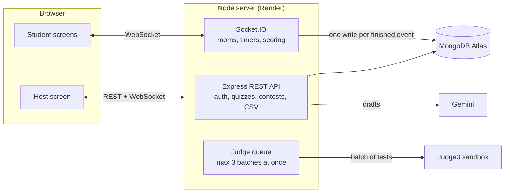

# Live Contest

**Live MCQ quizzes and LeetCode-style coding contests for a classroom.** A teacher creates an event (AI can draft it), students join from their phones or laptops with a room code and a nickname, and the server runs the timer, keeps the answers and hidden tests secret, judges code in a sandbox and updates a live leaderboard.

Built with React, Node.js, Express, Socket.IO, MongoDB, Gemini and Judge0.

## Features

**Two event types, one join flow** (room code + nickname, no student accounts)

| MCQ quiz | Coding contest |
|---|---|
| AI drafts 3–15 questions from a topic; the host reviews and edits | Up to **4 problems** with statement, examples, constraints and hidden tests |
| Per-question countdown owned by the server | One contest timer owned by the server |
| Faster correct answers score more (`500 + 500 × timeLeft / limit`) | Students write code in the browser (C++, Python, JavaScript, Java) |
| Answer bar chart, top 10 and own rank after every question | **Run** on the examples, **Submit** against the hidden tests |
| Final podium | Verdicts: Accepted, Wrong Answer, Time Limit Exceeded, Runtime Error, Compile Error |
| CSV export | LeetCode ranking: problems solved, then finish time + 5 min penalty per wrong submission |
| | Host sees every submission live (and the code), live leaderboard, CSV export |

**AI that is never trusted**
- Every Gemini answer must match a JSON schema and is checked with Zod; a bad answer is retried once with the list of problems.
- AI coding problems come with a **reference solution**. The server runs it on every example and hidden test in the Judge0 sandbox and **drops any test it fails** before the host sees the draft. In testing this caught 3 wrong expected outputs out of 90 AI-written tests.
- The host can write or edit everything and press **Verify** to re-run the check.

**Robust live play**
- Refresh or lose Wi-Fi mid-question or mid-contest: you rejoin with the same score, the correct time left and your code draft.
- Duplicate nicknames become `Riya (2)`. Rate limits on joins, AI drafts, runs and submissions.

## How it works



- **The server is the referee.** Correct MCQ answers are sent only in the reveal message; hidden tests and reference solutions never leave the server. A Submit result tells the student the verdict, how many tests passed and which test number failed, never the test itself (runtime error output is hidden too, because a program could print the hidden input).
- **Student code never runs on our server.** It goes to [Judge0](https://judge0.com) (open-source code-execution sandbox). One Run or Submit = one batch call. A server-wide queue keeps at most 3 batches in flight, so a whole class pressing Submit does not flood the free service.
- **Scales by summarising, not broadcasting.** Joins and answers update counters; the host gets a summary at most twice a second, the contest leaderboard goes out at most once a second, and the quiz leaderboard is sorted once per question. No database writes during a game: one `Session` document when it ends.

## Measured results

Full details in [docs/metrics.md](docs/metrics.md).

| What | Result |
|---|---|
| Live quiz load test (localhost, 500 bots × 5 questions) | **0 of 2,500 answers lost**, answer ack p95 **1.3 ms**, reveal reaches every bot within 15 ms (p95) |
| Judge verdicts in 4 languages (`npm run check:judge`) | **20/20** correct (AC, WA, TLE, RE, CE × C++, Python, JS, Java) |
| AI MCQ drafts | 10/11 valid first time, 11/11 after one retry, median 2.9 s |
| AI coding problems | 7/8 verified by the first check, 8/8 after one retry; 3 of 90 AI tests caught as wrong |
| Automated tests | 47 server + 3 client, all passing |

The load test runs bots and server on one laptop, so it is a best case; deployed numbers are not measured yet.

## Tech stack

| Layer | Choice |
|---|---|
| Frontend | React 19, Vite 8, Tailwind 4, React Router 8, CodeMirror 6 (lazy-loaded) |
| Real time | Socket.IO 4 (WebSocket transport only, compression off) |
| Backend | Node 24, Express 5, Zod 4, bcrypt + JWT for hosts |
| Database | MongoDB Atlas + Mongoose 9 |
| AI | Gemini via `@google/genai` (JSON schema output, model fallback list, 30 s timeout) |
| Code execution | Judge0 CE public instance (swappable: one module, `JUDGE0_URL`) |

## Run it locally

Needs Node 22+ and a MongoDB Atlas connection string. A Gemini key is only needed for AI drafts.

```powershell
cd server
copy .env.example .env    # then fill in MONGODB_URI, JWT_SECRET, GEMINI_API_KEY
npm install
npm run seed              # optional: demo host (DEMO_HOST_EMAIL / DEMO_HOST_PASSWORD in .env), a quiz and a contest
npm start                 # http://localhost:5002
```

```powershell
cd client
npm install
npm run dev               # http://localhost:5174
```

Open the client, create a host account (or log in as the demo host), press **Host live** on a quiz or contest, and join from another tab or your phone with the room code.

Useful scripts (in `server/`): `npm test`, `npm run check:judge` (verdicts on the real Judge0), `npm run check:gemini` (time each model), `npm run load-test -- --players 300`.

## Deploy (Render + Vercel)

- **Server on Render:** New → Blueprint → this repo (uses [render.yaml](render.yaml)). Fill in `MONGODB_URI`, `JWT_SECRET`, `GEMINI_API_KEY` and `CLIENT_URL` (your Vercel URL) in Render's dashboard. In MongoDB Atlas, allow Render's outbound IPs (or `0.0.0.0/0`).
- **Client on Vercel:** import the repo, root directory `client`, set `VITE_SERVER_URL` to the Render URL.

## Limitations (honest list)

- **Judge0 CE's public instance** is free and needs no key, but its limits are not published and it could change (the similar public Piston API closed in February 2026). Swapping to a self-hosted Judge0 or a paid plan is a config change (`JUDGE0_URL`, `JUDGE0_KEY`).
- A run takes a few seconds (network + compile), slower than LeetCode.
- Live rooms live in server memory: a server restart during an event ends it. Running several servers would need Redis (shared state + Socket.IO adapter), which is designed in the original spec but not built.
- Render's free plan sleeps after inactivity, so the first request after a break can take ~50 s.
- Python and JavaScript get extra time because Judge0's images for them spend ~1.1 s starting up.

## Built with AI assistance

I designed and directed this project and built it with heavy help from an AI coding assistant (Claude). I chose the features, made the key decisions (code runner, languages, problem format, how AI output is checked) and verified everything in the browser and with tests. Every number in this README was measured, not estimated. [LEARNING.md](LEARNING.md) explains how each part works in plain language.

Spec: [SPEC.md](SPEC.md) (the decisions) builds on the original "Live AI Quiz" spec.
